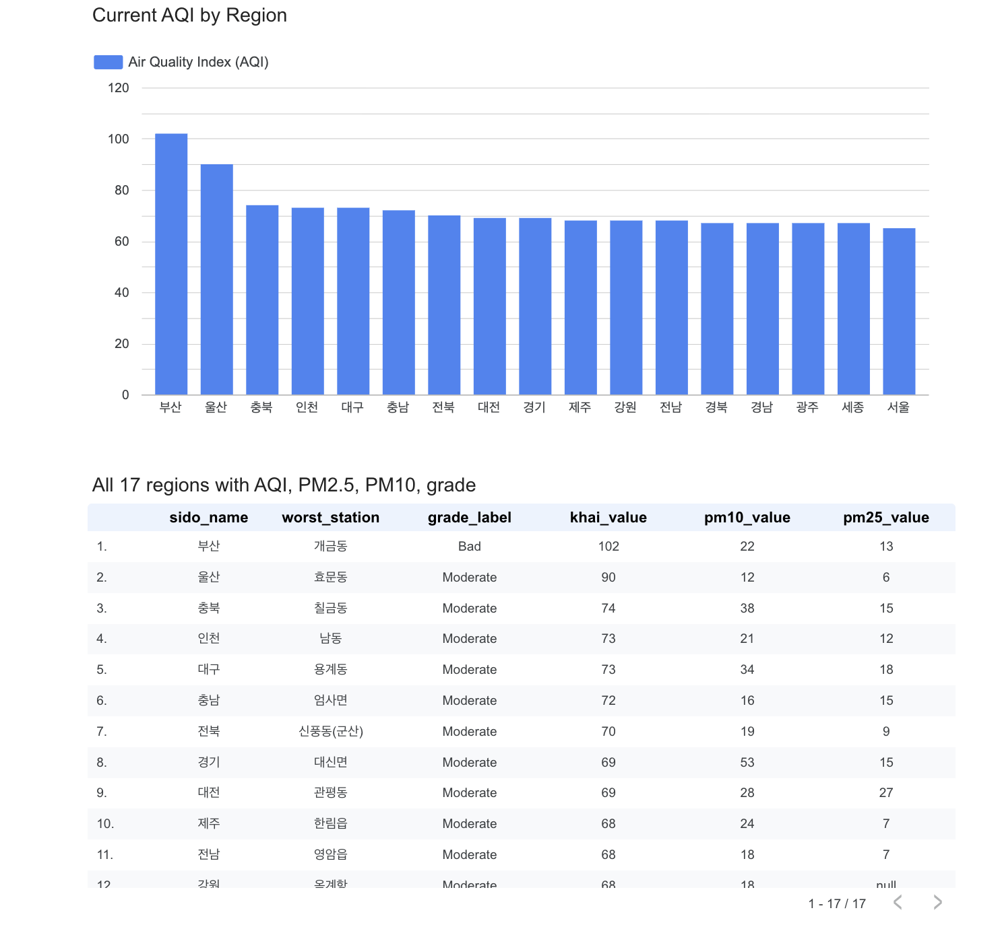
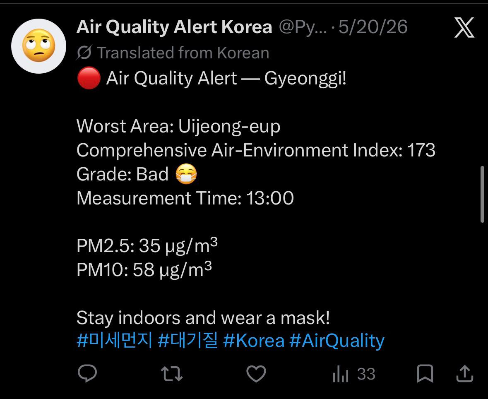
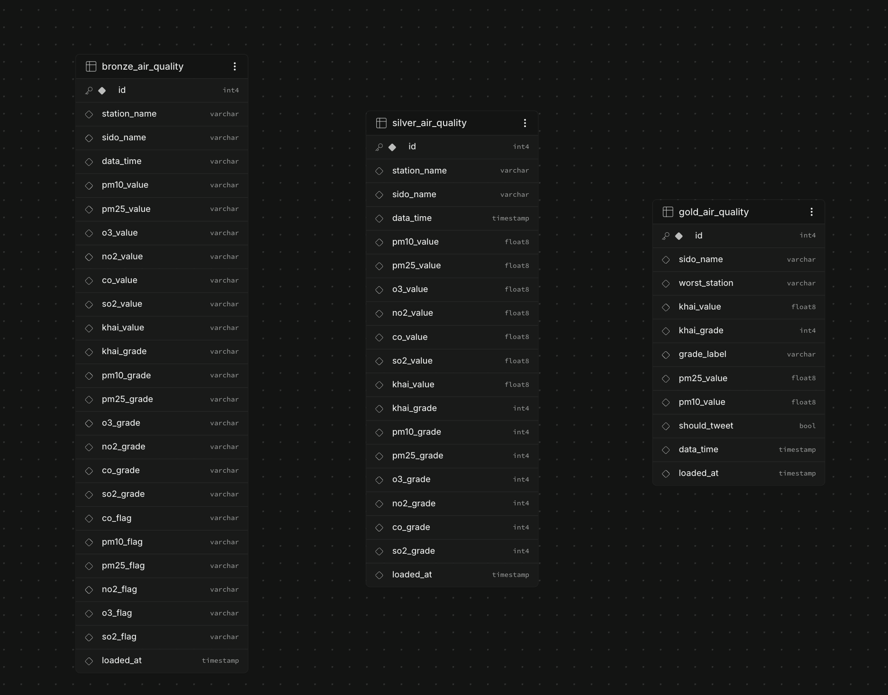
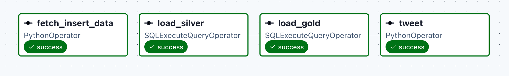

# 🌫️ Korea Air Quality Alert Pipeline

An automated data pipeline that pulls real-time air quality for all 17 regions of South Korea every hour, cleans it in a bronze → silver → gold layout, shows it on a dashboard, and posts an alert on X (Twitter) when a region reaches a "Bad" level.



---

## About the project

| | |
|---|---|
| **Problem** | Air quality data in Korea is published as raw per-station readings. It is hard to see at a glance which region is bad right now. |
| **What it does** | Every hour it fetches ~638 stations, keeps the full raw history, builds a clean table, and a one-row-per-region "current" table. A dashboard and an X bot read from that. |
| **Input** | AirKorea (Korea Public Data Portal) API: hourly readings from ~638 stations (AQI, PM2.5, PM10, O3, NO2, CO, SO2). |
| **Output** | Hourly-refreshed Looker Studio dashboard and automatic X alerts for regions with grade ≥ 3 (Bad). |
| **My role** | Solo project: I designed, built and ran everything myself (ingestion, database design, SQL transformations, orchestration, dashboard, alert bot). |
| **Duration** | About 1 week for the first working version, then ongoing fixes and improvements (for example the silver/gold rewrite on 10 Nov 2026). |
| **Design pattern** | Medallion architecture (bronze / silver / gold) |
| **Tools** | Python, SQL (PL/pgSQL), Apache Airflow 3, Docker, Supabase (PostgreSQL), tweepy, Looker Studio |

---

## Results

- Runs unattended every hour: **4 tasks, ~638 rows ingested per run, 85,000+ raw rows collected** so far.
- Dashboard shows all 17 regions (current AQI, PM2.5, PM10, grade, worst station).
- Alerts post automatically on X. Example posted by the pipeline on 10 Nov 2026 (Busan, AQI 102, "Bad"):



---

## 🏗️ Architecture


---

## 📊 Data layers

| Layer | Table | Content |
|---|---|---|
| Bronze | `bronze_air_quality` | Raw API response, appended every hour, never changed. Keeps the full history. |
| Silver | `silver_air_quality` | Typed and cleaned (`'-'` → NULL, VARCHAR → FLOAT/INT/TIMESTAMP), **one row per station per hour**. Full history. |
| Gold | `gold_air_quality` | **Current snapshot**: one row per region (the worst station among the latest readings), grade label, `should_tweet` flag. |

This is the **medallion architecture**: raw data is kept as-is in bronze, cleaned in silver, and shaped for the business question ("what is the air quality in each region right now?") in gold.



Bronze stores every column as text. Silver converts them to proper types (float, int, timestamp). Gold is small and ready for the dashboard and the bot.

A fourth table, `tweet_log`, stores which alerts were already posted (see problem 7).

Silver and gold are rebuilt by two SQL functions, `load_silver()` and `load_gold()`, run by Airflow right after ingestion.

---

## ⚙️ Airflow DAG

Runs every hour:

```
fetch_insert_data → load_silver → load_gold → tweet
```


| Task | Operator | Description |
|---|---|---|
| `fetch_insert_data` | PythonOperator | Calls the AirKorea API for all 17 regions, bulk inserts ~638 stations into bronze |
| `load_silver` | SQLExecuteQueryOperator | Runs `load_silver()` |
| `load_gold` | SQLExecuteQueryOperator | Runs `load_gold()` |
| `tweet` | PythonOperator | Reads gold, posts an alert for regions where `should_tweet = true` |

---

## 🧩 Problems I hit and how I fixed them

**1. Gold showed old data (all-time worst, not current).**
The dashboard still showed AQI 257 for 충남 from months ago. The gold query picked the worst station per region over *all* history instead of the latest readings. I rewrote `load_gold()` to first take each station's latest reading, keep only readings within 3 hours of the newest one, and then pick the worst station per region. After the fix the dashboard showed the real current values (max 102).

**2. Silver was 64% duplicates.**
Silver had 85,734 rows, the same as bronze, but only 30,897 unique station-hours. The API returns the same hourly reading again on every run. `load_silver()` now uses `DISTINCT ON (station_name, sido_name, data_time)` so silver has exactly one row per station per hour (verified: 0 duplicate groups). Bronze stays untouched as the raw record.

**3. Pipeline failed with "Name or service not known".**
The Supabase free project had been paused after inactivity, so the database host did not resolve. I restored the project and checked that no data was lost (row counts looked like 0 only because of estimated table statistics).

**4. Airflow UI unreachable (port 8080).**
Old containers were still holding the port, and the API server had lost its port mapping after I stopped compose with Ctrl+C. I stopped the old containers and recreated the API server with `docker compose up -d --force-recreate`.

**5. Docker and Airflow use a lot of RAM.**
Running Airflow in Docker (scheduler, API server, DAG processor, database) sometimes used so much memory that containers crashed and the pipeline stopped. This also made my EC2 deployment (t3.micro, Seoul region, 1 GB RAM) not workable, so for now it runs locally in Docker. I handled crashes by restarting with `docker compose up -d` and checking the scheduler logs. A possible fix is a bigger instance or adding swap.

**6. Messy API values.**
Missing readings arrive as `'-'`. Bronze stores everything as text so nothing is lost; silver converts them to NULL, and gold ignores rows with no AQI.

**7. The bot repeated the same alert every hour.**
The first version tweeted every region marked "Bad" on every run, so one region that stayed bad would be tweeted 24 times a day. I added a small `tweet_log` table. Before tweeting, the bot checks it and only sends an alert if the region has no alert in the last 24 hours, or if its grade got worse (for example Bad → Very Bad). Each alert is logged right after it is posted, so an Airflow retry cannot post it twice. The rule is a small function (`should_send_alert`) that I tested with four cases (new region, same grade, worse grade, cooldown over).

---

## 🛠️ Tech stack

| Layer | Technology |
|---|---|
| Data source | Korea Public Data Portal, AirKorea API |
| Ingestion | Python (requests, pandas) |
| Storage | Supabase (PostgreSQL) |
| Transformation | SQL (PL/pgSQL stored functions) |
| Orchestration | Apache Airflow 3 (Docker Compose) |
| Alerting | X (Twitter) bot, tweepy |
| Visualization | Looker Studio |

---

## 🌡️ Air quality metrics

| Metric | Description | Dangerous level |
|---|---|---|
| `khai_value` | Overall Air Quality Index (CAI) | > 100 |
| `khai_grade` | Grade 1–4 (1 = Good, 4 = Very Bad) | >= 3 |
| `pm25_value` | Ultra-fine dust PM2.5 (μg/m³) | > 35 |
| `pm10_value` | Fine dust PM10 (μg/m³) | > 80 |
| `o3_value` | Ozone (ppm) | > 0.09 |
| `no2_value` | Nitrogen dioxide (ppm) | > 0.1 |

---

## 📁 Project structure

```
├── dags/
│   └── air_quality_alert_dag.py   # Airflow DAG, hourly pipeline
├── api/
│   └── ingest.py                  # AirKorea API ingestion
├── database/
│   ├── database.py                # Supabase connection and queries
│   ├── init_bronze_layer.sql      # Bronze table
│   ├── init_silver_layer.sql      # Silver table
│   ├── init_gold_layer.sql        # Gold table
│   ├── init_tweet_log.sql         # Table that remembers sent alerts
│   ├── load_silver.sql            # load_silver() function
│   └── load_gold.sql              # load_gold() function
├── twitter/
│   └── bot.py                     # X alert bot
├── images/                        # README screenshots
├── docker-compose.yaml            # Airflow setup
├── .env.example                   # Environment variable template
└── README.md
```

---

## 🚀 Getting started

### Prerequisites
Docker Desktop, Python 3.10+, a free Supabase account, a Korea Public Data Portal account (free), an X Developer account.

### 1. Clone
```bash
git clone https://github.com/Umid-R/-Korea-Air-Quality-Alert-Pipeline.git
cd -Korea-Air-Quality-Alert-Pipeline
```

### 2. Environment variables
```bash
cp .env.example .env
```
Fill in your keys in `.env` (never commit this file).

### 3. Create the Supabase tables
In the Supabase SQL editor, run in this order:
`init_bronze_layer.sql`, `init_silver_layer.sql`, `init_gold_layer.sql`, `init_tweet_log.sql`, `load_silver.sql`, `load_gold.sql` (all in `database/`).

### 4. Start Airflow
```bash
docker compose up airflow-init
docker compose up -d
```

### 5. Add the Airflow connection
Open `http://localhost:8080` → Admin → Connections → Add:
```
Conn Id:   supabase_postgres
Conn Type: Postgres
Host:      <your Supabase pooler host>
Database:  postgres
Login:     <your Supabase DB user>
Password:  <your DB password>
Port:      5432
```

### 6. Enable the DAG
Toggle `air_quality_alert_dag` on. It then runs every hour.

---

## 📈 Looker Studio dashboard

- **Daily report:** current AQI per region, ranking bar chart, table with AQI, PM2.5, PM10, grade and worst station.
- **Historical report:** AQI over time with region filter.

Live report: https://datastudio.google.com/reporting/d5d4fe31-29f5-4655-9d02-14dae1d4fa68

---

## 📬 X alert bot

The bot posts when a region reaches grade 3 (Bad) or 4 (Very Bad). It does not repeat itself: a region is tweeted again only after 24 hours, or sooner if its grade gets worse. Messages are written in Korean.

```
🔴 Air Quality Alert — 경기!

Worst area: 의정부읍
AQI: 173
Grade: Bad 😷
Time: 13:00

PM2.5: 35 μg/m³
PM10: 58 μg/m³

Stay indoors and wear a mask!
#미세먼지 #대기질 #Korea #AirQuality
```

---

## Next steps

- Deploy on a small always-on server with enough RAM (a larger instance, or add swap).
- Add a short test suite and a GitHub Actions check.

---

## 📄 License

MIT License
